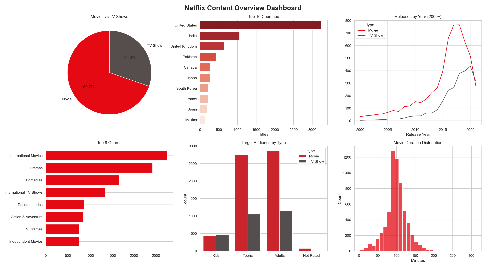

# Netflix Data Analysis Using Python

**Auspify Technologies | Data Analysis Using Python Internship**

## Overview
End-to-end analysis of 8,786 Netflix titles covering data cleaning, content type,
country analysis, release trends, ratings and genres, and a final business insights report.

## Tasks Completed
1. Netflix Data Cleaning & Preparation
2. Content Type Analysis Dashboard
3. Country-Wise Netflix Content Analysis
4. Trend Analysis by Release Year
5. Content Rating & Genre Analysis
6. Netflix Business Insights Report

## Tools & Libraries
Python, Pandas, NumPy, Matplotlib, Seaborn, Plotly, Jupyter Notebook (VS Code)

## Key Findings
- The catalog is movie-heavy: 69.7% Movies vs 30.3% TV Shows.
- The US (36.9%), India (12.0%) and the UK (7.3%) lead content production.
- Additions to the platform peaked in 2019 (2,013 titles) and slowed in 2020.
- Only about 10% of titles target kids; adults and teens make up about 89%.

## Dashboard Preview


## Project Structure
```
netflix-project/
├── data/
│   ├── raw/Dataset.csv
│   └── cleaned/netflix_cleaned.csv
├── notebooks/netflix_analysis.ipynb
├── charts/
├── report/
├── requirements.txt
└── README.md
```

## How to Run
```bash
pip install -r requirements.txt
jupyter notebook notebooks/netflix_analysis.ipynb
```

## Author
[Mohamed Ashraf] | [https://www.linkedin.com/in/mozaaa]